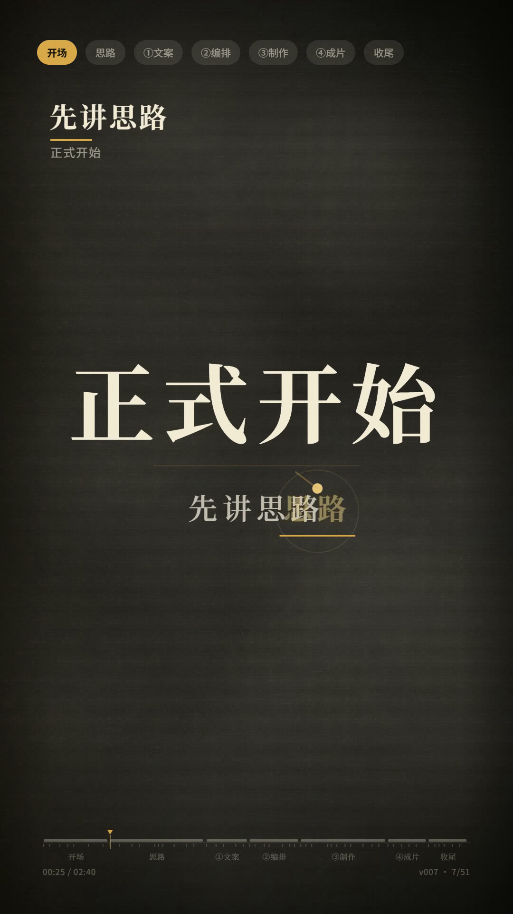
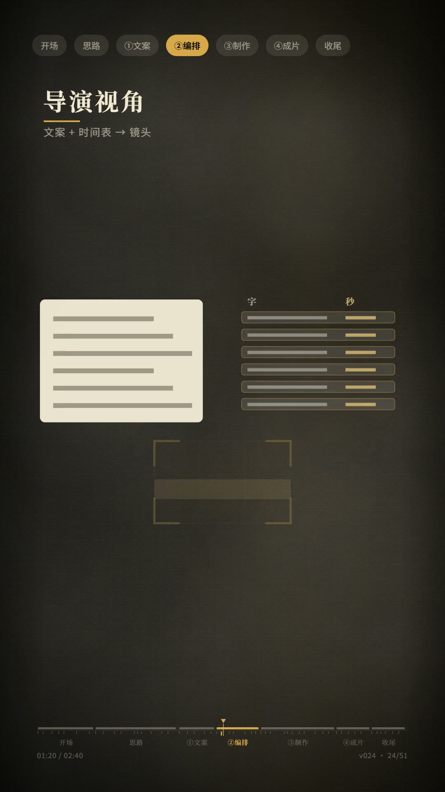
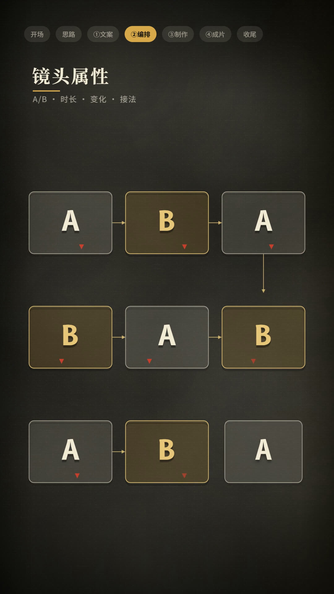
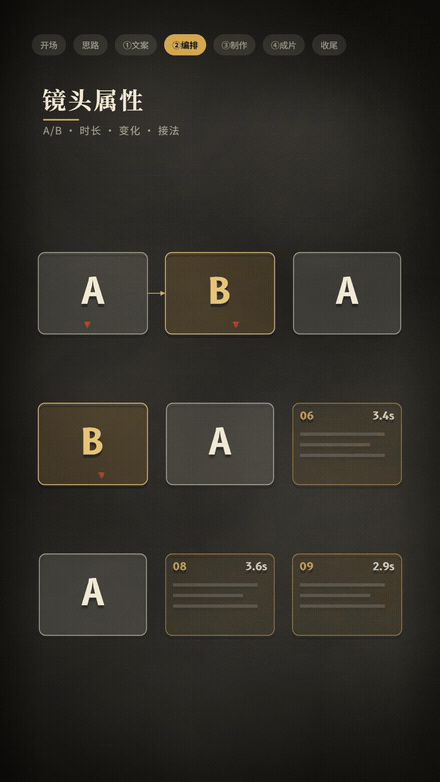
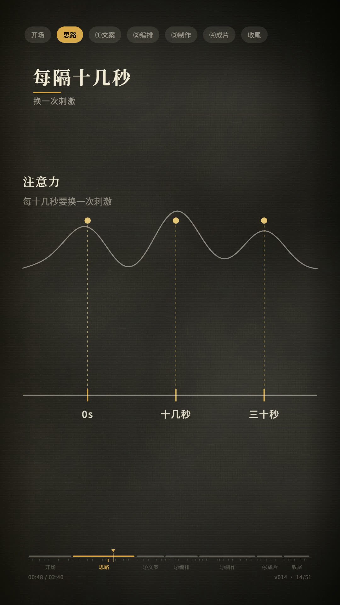
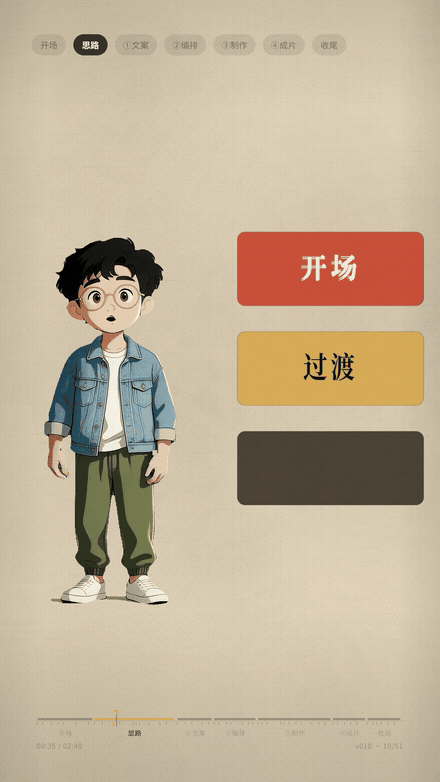
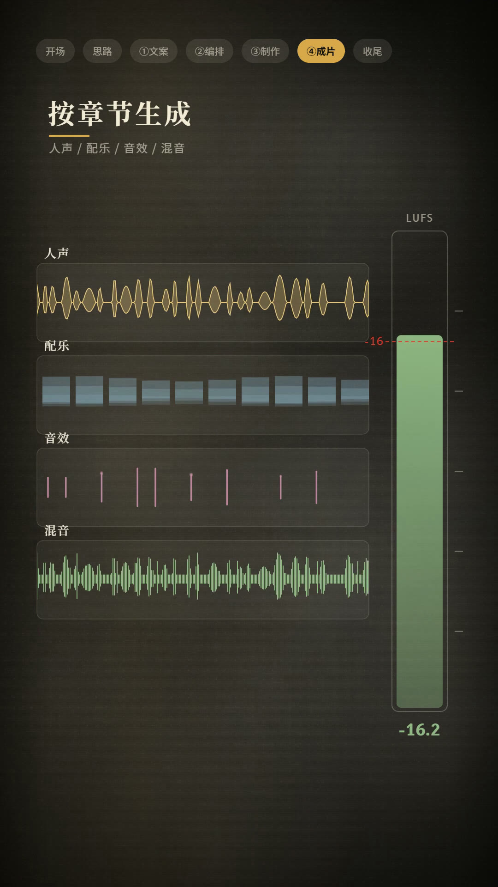
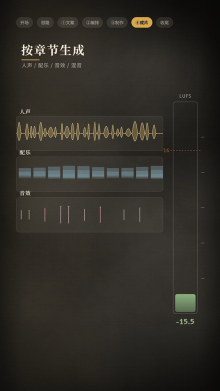

# 《用代码做视频》· Agent 画面制作指南

> 这份文档按**本作品视频的叙事顺序**，讲清楚一件事：**Agent 是如何用代码把视频画面一帧一帧画出来的**。
> 全程零图片模型、零视频模型——你看到的每一帧，都是 Canvas 上的代码执行结果。



---

## 第〇幕 · 开场：画面不是"生成"的，是"画"的

传统 AI 视频：提示词 → 模型抽卡 → 每帧可能漂移 → 改一个字重抽。

本 skill 的路线：

```
台词稿 → 句级时间轴 → 动画编排表（BEATS）→ Canvas 逐帧绘制 → 无头浏览器渲染 → 自动混音 → 自检
```

**改需求 = 改一个数字**：卡片位置、出现时刻、颜色、字号全是参数，重新渲染即可确定性复现。

---

## 第一幕 · ①文案：台词拆成 51 句，每句一个时间预算

视频里说"画面、动效、配乐全是代码画的"，起点是台本：

- 台词按句切开 → 每句一个 wav → 天然得到 `timeline.json`（句 id + t0/t1 + 文字）
- **配音来源不限**：任何 TTS / 声音克隆 / 真人录制都行（本 skill 不绑定任何音频模型）
- 一句话 = 一个动画预算：这句话期间，谁出现、怎么出现、在哪出现，全部写死，不靠运气

---

## 第二幕 · ②编排：先做"动画编排表"，再动手写代码




视频里"站在导演视角，把文案拆成一个个镜头"，落到代码就是 `BEATS` 数组——**每句台词一条编排**：

```js
{
  vs: ['v026'],            // 覆盖哪句话
  bg: 'ink',               // B-roll（墨黑讲理）/ 'paper' = A-roll（暖纸讲人）→ 主题自动切换
  cap: '这段是 A 还是 B',   // 章内小标题
  box: [120, 480, 840, 900], // 内容外接矩形 = 裁剪窗口
  mo: 5,                   // 入场手法 0–7：上推/擦除/缩放/劈开/绘制/落下/滑动/原地
  vis: visShotLabels(),    // 画面主体函数（自由组合动效工具）
}
```



> 上图：镜头卡阵原地裂开 + 九卡翻转（`mo` 手法 + 手写 `scaleX` 翻面配方），完全由代码计算几何。

---

## 第三幕 · ③制作：Canvas 逐帧作画

视频里说"矢量图，加动画，浏览器一帧一帧渲染成视频"——这是引擎的核心循环：

```js
for (let i = 0; i < N; i++) {
  window.seek(t0 + i / fps);        // 定格到这一帧的时刻
  Page.captureScreenshot();          // CDP 截帧
}
→ ffmpeg 编码成 mp4
```

画面元素全部是矢量绘制（路径/文字/渐变），配合三套工具：

| 层 | 工具 | 例 |
|---|---|---|
| 入场手法 | `mo: 0–7` | 落下（砸卡）、擦除（列表铺开）、劈开（A/B 对比） |
| 缓动数学 | `pt / springAt / quintic / eOutBack` | 贝塞尔、弹性、压扁回弹 |
| 绘制原件 | `text / rr / drawSlamCard` | 排字、圆角、砸卡卡片 |




> 左：代码画出的注意力曲线+时间轴；右：三词依次砸落三色卡（词随台词语义、卡随设计节奏）。

---

## 第四幕 · ④成片：音画对点，踩上音乐重拍




视频里"补声音"这一章，在工程里是三件事：

1. **声点表**（`sfx_map.json`）：每个音效对应**元素开始动/落地的那一刻**——146 个声点全部对齐动画事件
2. **踩拍**：开场 12 幕切点吸附到真实拍网格（`0.35 + n × 60/BPM`），渲后用场景检测实测校验（偏差 ±40ms 内）
3. **BGM 双轨**：开场炫技版（126.5 BPM）与正文讲解版（84 BPM 带重音）自动分段混入


> 响指切黑：声点 snap 精确落在 58.23s，实测全段最尖瞬态正打在响指瞬间。

---

## 第五幕 · 自检：过三道门禁才算交付

```bash
node engine/build.js                        # 构建全片
python engine/check_static.py 04_成片/全片_*.mp4   # 死长静止 >0.5s = 不合格
```

- **动态门**：check_static 揪"死长静止 / 一闪而过"
- **音画门**：声点↔动画事件、切点↔拍网格对齐校验
- **几何门**：`box` 必须等于内容外接矩形（否则 morph/split/wipe 会裁掉内容）

---

## 附：默认主题与 A/B-roll 自动区分

一句 `bg` 字段，自动套用主题（无需手写颜色）：

| | A-roll（`bg:'paper'`） | B-roll（`bg:'ink'`） |
|---|---|---|
| 底色 | 暖纸 `#E6D8BC` + 颗粒 | 墨黑 `#141310` + 暗角 |
| 文字 | 深墨 `#3A3226` | 暖白 `#F3EBD6` |
| 强调 | 金 `#D9A94A` | 金 `#D9A94A` |
| 语义 | 讲人：人物位、慢、留白 | 讲理：卡片/图表/对比、快 |

动效配方见 [`motion/README.md`](../motion/README.md)（砸卡/擦入/劈开/弹入/翻卡/生长，按需求类目表选）。

---

## 快速开始

```bash
# 一键安装（发给你的 AI Agent）
帮我安装这个项目，安装完成后按 SKILL.md 带我创建第一个视频工程：
https://github.com/gigizhang0527-cmyk/code-video-skill
```

完整实例（本视频的 51 句全代码）在 [`examples/`](../examples/README.md)——每句台词对应的 vis 函数都能直接翻。
